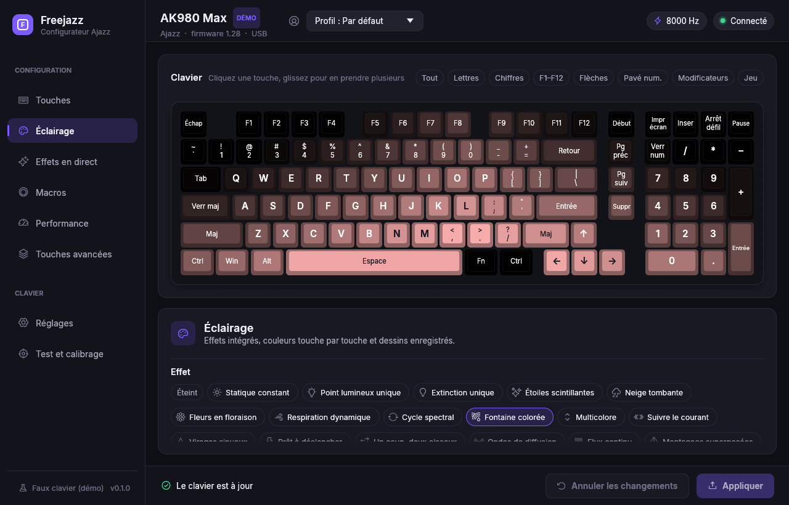
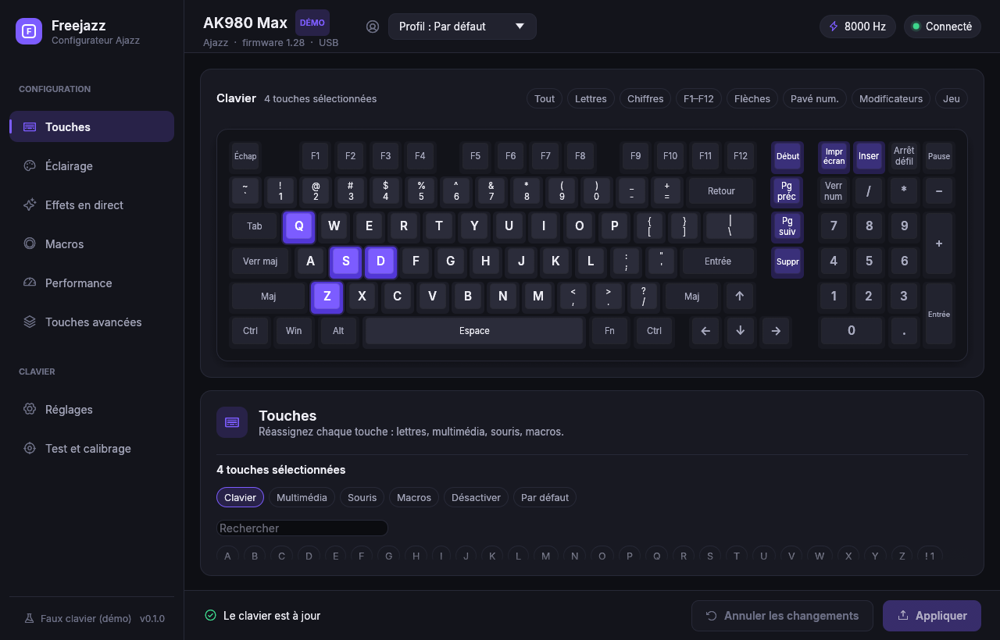
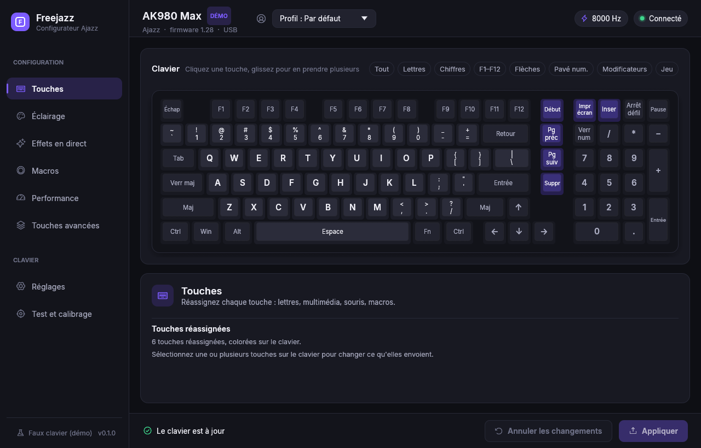

# Freejazz

Configurateur Windows natif pour le clavier magnétique **Ajazz AK980 Max** (USB `0C45:8043`).
Il remplace le site WebHID d'Ajazz, sans navigateur : un seul programme Rust (egui), sans vue web.
Interface en français. Projet libre (licence MIT), sans lien avec Ajazz.







*Captures faites avec le faux clavier de démonstration (`--mock`).*

## Installer et mettre à jour

1. Téléchargez `freejazz-vX.Y.Z-windows-x86_64.zip` (et son `.sha256`) depuis la page [Releases](https://github.com/fraustiz/freejazz/releases).
2. Vérifiez la somme de contrôle si vous le souhaitez : `(Get-FileHash .reejazz-vX.Y.Z-windows-x86_64.zip).Hash` doit donner le contenu du `.sha256` (en minuscules).
3. Décompressez le zip où vous voulez : `freejazz.exe` (l'appli) et `freejazz-cli.exe` (la ligne de commande) n'ont pas d'installeur.

**Mise à jour intégrée** : Freejazz cherche une nouvelle version au démarrage (Réglages, « Rechercher les mises à jour au démarrage », activé par défaut ; désactivable) et à la demande (« Rechercher maintenant »). Si une version plus récente existe, Réglages affiche ses notes et un bouton « Mettre à jour » : rien n'est installé sans ce clic. L'appli télécharge alors l'archive de la version depuis GitHub (HTTPS, hôtes GitHub uniquement), vérifie sa somme SHA-256, arrête proprement l'effet en direct, remplace `freejazz.exe` (et `freejazz-cli.exe` s'il est à côté) puis se relance. Les erreurs réseau de la recherche automatique sont silencieuses ; en mode `--mock` la mise à jour est inactive.

## Ce que fait Freejazz

- **Touches** : clavier dessiné, remappage touche par touche, groupes de sélection.
- **Éclairage** : effets intégrés du clavier avec aperçu animé, couleurs touche par touche, bibliothèque de designs.
- **Effets en direct** : effets calculés par Freejazz et envoyés en flux (25 images/s) : onde, profondeur, chaleur, ambiances, égaliseur, jauge système, effets personnalisés à calques.
- **Macros** : enregistrement au clavier, éditeur, capacité de 512 octets (règle du site).
- **Performance** : course et seuils magnétiques par touche.
- **Touches avancées** : DKS, Mod-Tap, Toggle, SOCD, RS.
- **Réglages** : fréquence d'envoi (1000, 4000, 8000 Hz), mode de stabilité, calibration adaptative, sauvegardes (restaurer, exporter, importer), remises à zéro.
- **Test et calibrage** : testeur de touches et calibrage.
- **Profils** (fichiers sur le PC, le clavier n'a pas de profils matériels) et **zone de notification** : fermer la fenêtre la réduit, le menu propose Ouvrir, Arrêter l'effet, Quitter.

Les données (réglages, profils, designs, sauvegardes) vivent dans `%APPDATA%\Freejazz\`.

## Compiler

Depuis **PowerShell** (Git Bash ne voit pas le linker MSVC) :

```powershell
.\build.ps1
```

Le script lance `cargo build --release -p freejazz -p freejazz-cli` puis copie `freejazz.exe` et `freejazz-cli.exe` dans `dist\`.

Pour préparer une version publiable (la version est celle de `Cargo.toml`) :

```powershell
.
elease.ps1
```

Il compile puis crée `distreejazz-v<version>-windows-x86_64.zip` (les deux exécutables, `README.md`, `LICENSE`) et `…zip.sha256` (hash en minuscules, deux espaces, nom du fichier).

## Lancer

```powershell
.\dist\freejazz.exe            # le clavier branché, configuration réelle
.\dist\freejazz.exe --mock     # faux clavier de démonstration, aucune écriture
.\dist\freejazz.exe --tray     # démarre dans la zone de notification, fenêtre masquée
```

Autres options : `--offline` (sans clavier), `--section <id>`, `--theme dark|light`, `--screenshot <png>` et `--offscreen` (fenêtre hors de l'écran, pour les captures et les mesures).

Une seule instance à la fois : relancer Freejazz affiche la fenêtre de la première. « Lancer avec Windows » (Réglages, désactivé par défaut) inscrit `freejazz.exe --tray` dans la clé `Run` de l'utilisateur.

## Ligne de commande

`freejazz-cli.exe <commande>` (`--verbose` affiche chaque rapport HID) :

| Commande | Effet |
| --- | --- |
| `devices` | liste les interfaces HID du clavier, sans rien envoyer |
| `info` | lit les informations du clavier |
| `backup [dossier]` | lit tout le clavier et écrit une sauvegarde JSON |
| `dump <bloc>` | lit un bloc (game-mode, keys, led, custom-leds, macros, magnetic, dks…) et l'affiche |
| `restore <fichier> --confirm` | réécrit une sauvegarde puis la relit |
| `selftest-writes --confirm` | essaie chaque écriture de bloc, sauvegarde et restauration comprises |
| `stream-test --confirm` | flux en direct d'essai, mesure des images/s |
| `depth-test` | lit la course des touches (commande jamais envoyée par le site) |

Les commandes qui écrivent ne font rien sans `--confirm`.

## Sûreté

- **Aucune écriture sans action explicite**, et **aucune écriture tant qu'une sauvegarde du clavier n'existe pas** ; toute restauration ou remise à zéro est précédée d'une sauvegarde « avant restauration ».
- **Liste noire codée** : jamais de mise à jour du firmware (0x80 à 0x86), ni 0x4F, 0x50, 0x51, 0x40 à 0x42.
- Chaque modification part d'une **copie** du bloc reçu : les champs bruts inconnus sont conservés tels quels.
- Les fonctions que le site n'envoie pas à ce modèle (couche Fn, profondeur d'appui, remises à zéro partielles, calibrage) sont **désactivées** tant que « Fonctions expérimentales » n'est pas activé, à chaque démarrage.
- Un effet en direct est toujours terminé proprement (fin de flux, effet mémorisé du clavier remis) à l'arrêt, à la sortie, par « Quitter » et en cas de plantage.

## Mémoire

Mesures du jeu de travail (`--mock --offscreen`, version release, Windows 11) :

| État | Jeu de travail |
| --- | --- |
| Fenêtre ouverte, après le démarrage | 76 à 85 Mo lors de la première mesure, environ 148 Mo ensuite (voir la note) |
| Fenêtre ouverte, inactive plus de 90 s | environ 8 Mo (le jeu de travail est rendu à Windows) |
| Fenêtre masquée dans la zone de notification | environ 14 Mo |

Note : la valeur « ouverte » dépend fortement du pilote graphique OpenGL (même chiffre sans clavier, et avant l'ajout de la zone de notification). Cible : moins de 80 Mo ouverte, moins de 40 Mo masquée. Une fenêtre masquée ne dessine rien ; le jeu de travail est réduit au masquage, puis chaque minute, et après 90 s d'inactivité fenêtre ouverte.

## À vérifier sur le matériel

Construit d'après le protocole mais **jamais essayé sur le clavier** (marqué `UNVERIFIED-HW` dans le code) :

- couche **Fn** (lecture et écriture) ;
- **remises à zéro partielles** (touches, éclairage, macros) ; seule « Tout remettre à zéro » est celle du site ;
- **calibrage** ;
- **profondeur d'appui** (0x60, 0x68, test 0x66/0xFB), dont les effets en direct dépendant de la profondeur ;
- **profils matériels** : ce clavier annonce `max_profile` 0, les profils sont donc des fichiers côté PC ;
- **flux en direct sur le clavier réel** sur la durée (25 images/s, perte d'images plutôt que file d'attente) ;
- **crochet clavier** global (enregistrement de macros, test des touches, effets réactifs) ;
- zone de notification, instance unique et lancement avec Windows sur une session réelle ;
- relecture d'un effet lumineux : le firmware renvoie du blanc juste après l'écriture, les comparaisons l'ignorent (comportement connu, le site aussi).

## Icônes et licences

- **Licence du projet** : MIT, voir [`LICENSE`](LICENSE). Freejazz n'est ni affilié à Ajazz ni approuvé par cette marque ; les tables d'effets et de touches de `data/` sont des faits techniques relevés dans son configurateur web.
- Icônes des effets : bibliothèques Carbon (Apache-2.0) et Ionicons (MIT), voir `crates/freejazz-app/assets/effects/ORIGINE.md`.
- Police Inter (licence OFL, `crates/freejazz-app/assets/fonts/Inter-OFL.txt`) et icônes de l'interface Phosphor (MIT).
